# Laporan Praktikum 5: JavaScript Dasar dan Manipulasi HTML

**Mata Kuliah:** Pemrograman Web  
**Dosen Pengampu:** Agung Nugroho, S.Kom., M.Kom.  
**Universitas Pelita Bangsa**

---

## 👨‍💻 Data Diri Mahasiswa
* **Nama:** Guntur Cahyadewangga
* **NIM:** 312510265
* **Program Studi:** Teknik Informatika
* **Kelas / Semester:** I251C / Semester 3

---

## 📝 Penjelasan Praktikum
Praktikum 5 mempelajari dasar-dasar bahasa pemrograman **JavaScript** serta interaksinya dengan elemen halaman web menggunakan **Document Object Model (DOM)**. Pada praktikum ini, kita mempelajari cara menyisipkan skrip eksternal (`script.js`), penggunaan variabel (`let`, `const`), tipe data, operator aritmetika dan perbandingan, percabangan (`if-else`, `switch`), perulangan (`for`), pembuatan fungsi (*function*), kotak dialog interaktif (`alert`, `prompt`), manipulasi konten serta gaya CSS elemen HTML, penanganan form, validasi input, hingga menyelesaikan Mini Project Kalkulator Nilai Mahasiswa beserta rangkaian Eksperimen Mandiri (7 sampai 11).

---

## 🛠️ Langkah-Langkah & Hasil Praktikum (`Lab5Web`)

### 1. Output, Aritmetika, & Console (`index.html` & `script.js`)
* **Penjelasan:** Menampilkan teks "Hello World" ke elemen HTML via manipulasi DOM (`textContent`), mencetak log pesan ke Console browser, serta mengeksekusi fungsi aritmetika dasar (`operasiDasar(9, 4)`).
* **Screenshot Hasil:**  
  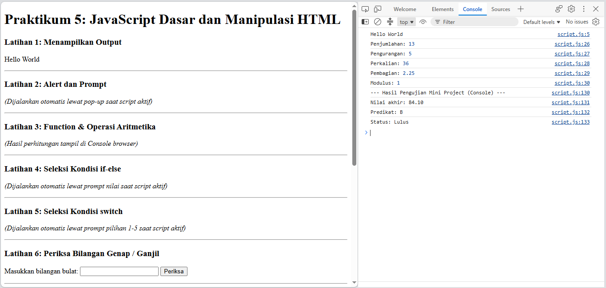

### 2. Dialog Interaktif Prompt & Alert (Latihan 2)
* **Penjelasan:** Meminta input nama pengguna melalui kotak dialog `prompt()` dan menampilkan kembali pesan sapaan khusus menggunakan pesan peringatan `alert()`.
* **Screenshot Dialog Box:**  
  * **Input Nama:**  
    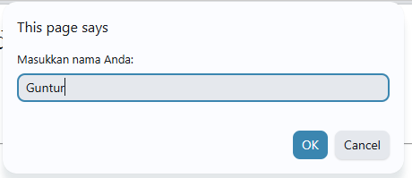  
    *Pengguna memasukkan nama "Guntur" pada kotak dialog `prompt()`.*
  * **Output Alert:**  
    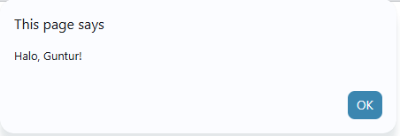  
    *Browser menampilkan dialog `alert()` berisi pesan sapaan "Halo, Guntur!".*

### 3. Percabangan Kondisi Nilai Kelulusan (Latihan 4)
* **Penjelasan:** Meminta input angka nilai (0-100) dari pengguna via `prompt()`, lalu menguji kondisi logika `if (nilai >= 60)` untuk menentukan status kelulusan yang ditampilkan via `alert()`.
* **Screenshot Dialog Box:**  
  * **Input Nilai:**  
    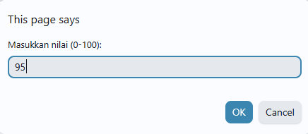  
    *Pengguna memasukkan angka nilai "95" pada kotak dialog `prompt()`.*
  * **Output Status Kelulusan:**  
    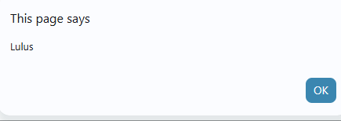  
    *Browser menampilkan dialog `alert()` bertuliskan "Lulus" karena nilai memenuhi kondisi `>= 60`.*

### 4. Percabangan Multi-Kondisi Switch Case (Latihan 5)
* **Penjelasan:** Menggunakan struktur percabangan `switch` untuk mencocokkan input angka (1-5) dari `prompt()` dengan nama bilangan terbilang yang sesuai via `alert()`.
* **Screenshot Dialog Box:**  
  * **Input Angka 1-5:**  
    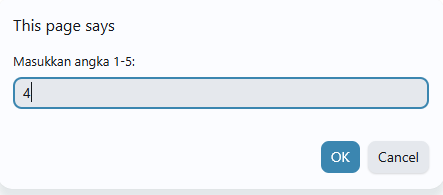  
    *Pengguna memasukkan angka "4" pada dialog `prompt()`.*
  * **Output Terbilang:**  
    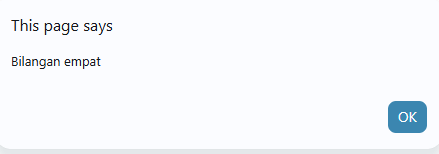  
    *Browser mencocokkan `case 4` dan menampilkan dialog `alert()` bertuliskan "Bilangan empat".*

### 5. Form Bilangan Genap atau Ganjil (Latihan 6)
* **Penjelasan:** Membuat form input angka bulat yang memvalidasi masukan serta memeriksa apakah bilangan tersebut genap atau ganjil menggunakan operator modulus (`angka % 2 === 0`).
* **Screenshot Hasil:**  
  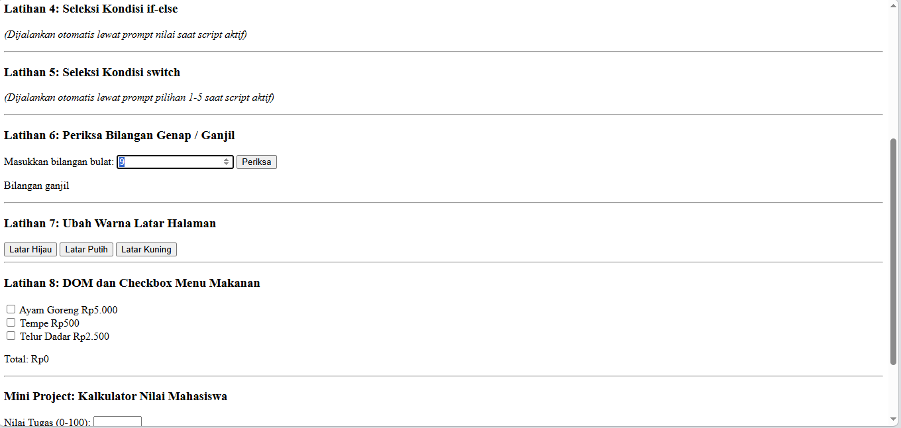

### 6. Mengubah Warna Latar Halaman (Latihan 7)
* **Penjelasan:** Memanfaatkan fungsi berparameter untuk memodifikasi properti gaya CSS latar belakang halaman web secara dinamis (`document.body.style.backgroundColor`) saat tombol diklik.
* **Screenshot Hasil:**  
  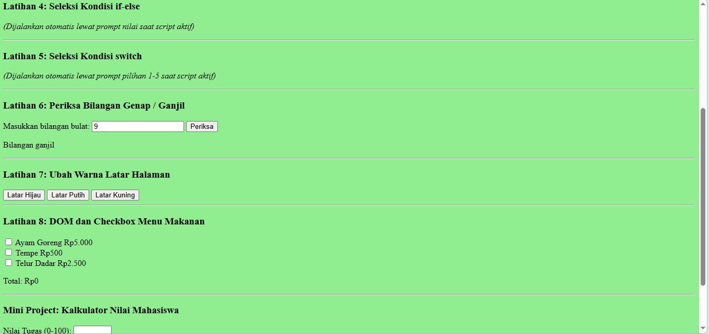

### 7. DOM & Checkbox Menu Makanan (Latihan 8)
* **Penjelasan:** Menggunakan *event listener* `change` pada elemen *checkbox* daftar menu makanan untuk menghitung total harga secara otomatis dan memformatnya ke format mata uang Indonesia.
* **Screenshot Hasil:**  
  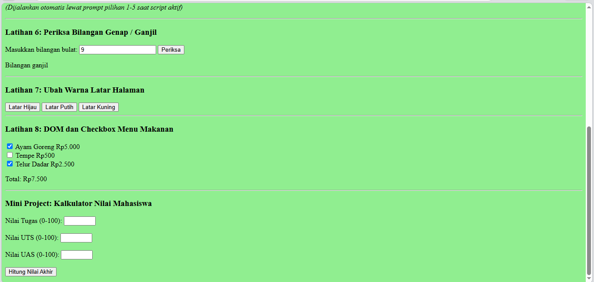

### 8. Mini Project: Kalkulator Nilai Mahasiswa
* **Penjelasan:** Membangun kalkulator penilaian yang menerima input nilai Tugas, UTS, dan UAS, melakukan validasi rentang angka (0-100), menghitung Nilai Akhir berbobot, menentukan Predikat (A-E), serta menampilkan Status Kelulusan langsung pada halaman HTML.
* **Screenshot Hasil:**  
  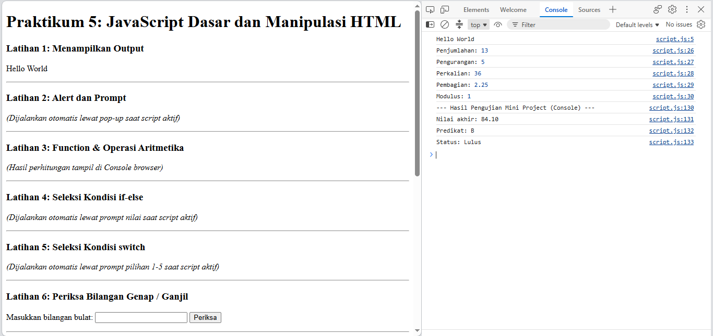  

* **Pengujian Variasi Nilai Kalkulator:**  
  * **Pengujian 1 (Nilai Akhir: 91.10 - Predikat A):**  
    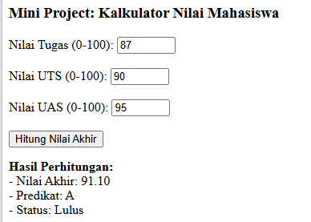  
  * **Pengujian 2 (Nilai Akhir: 89.00 - Predikat A):**  
    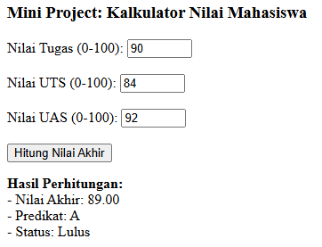  
  * **Pengujian 3 (Nilai Akhir: 94.40 - Predikat A):**  
    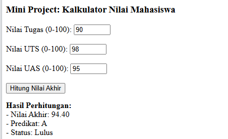

### 9. Eksperimen Mandiri 7: Tabel Perkalian 7
* **Penjelasan:** Membuat struktur perulangan `for` di dalam file `script.js` untuk mencetak tabel perkalian angka 7 secara berurutan dari 1 sampai 10 ke dalam Console browser.
* **Screenshot Hasil:**  
  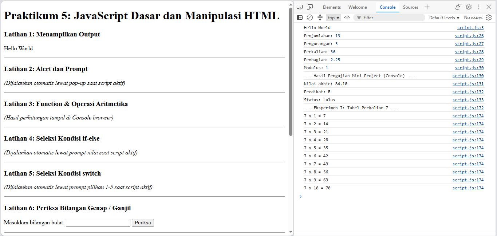

### 10. Eksperimen Mandiri 8: Fungsi `cekGenap(angka)`
* **Penjelasan:** Membuat fungsi khusus bernama `cekGenap(angka)` yang mengembalikan nilai boolean `true` jika bilangan bernilai genap dan `false` jika ganjil, lalu mengujinya melalui Console.
* **Screenshot Hasil:**  
  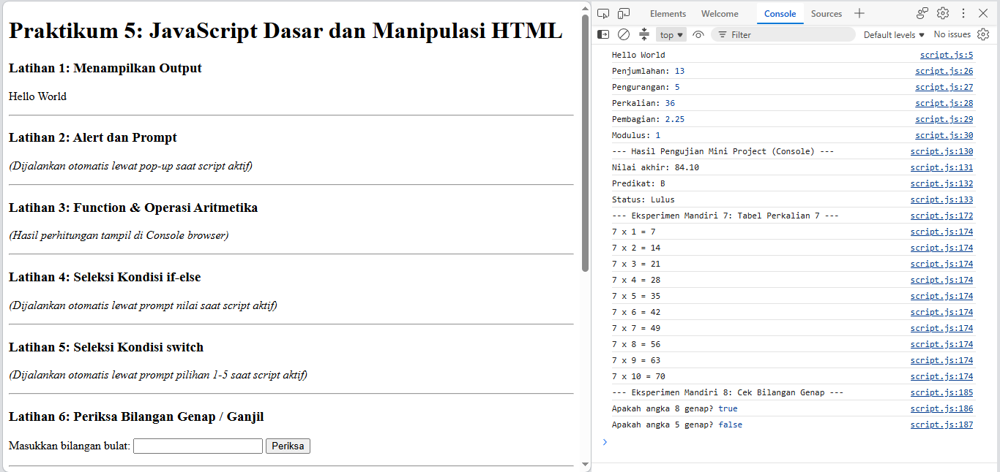

### 11. Eksperimen Mandiri 9: Validasi Form Kosong
* **Penjelasan:** Menambahkan fungsi validasi pada form input teks agar memberikan peringatan berwarna merah jika pengguna mencoba memvalidasi dalam keadaan kolom kosong.
* **Screenshot Hasil:**  
  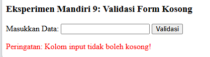

### 12. Eksperimen Mandiri 10: Tambah Pilihan Menu Makanan
* **Penjelasan:** Memperluas daftar menu makanan pada Latihan 8 dengan menambahkan dua pilihan menu baru (Nasi Putih dan Es Teh Manis) serta menguji perhitungan total harga secara dinamis.
* **Screenshot Hasil:**  
  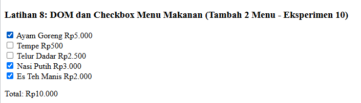

### 13. Eksperimen Mandiri 11: Toggle Sembunyikan / Tampilkan Elemen HTML
* **Penjelasan:** Membuat tombol interaktif yang memanfaatkan fungsi JavaScript untuk menyembunyikan (`display: none`) atau menampilkan kembali (`display: block`) elemen teks rahasia pada halaman web.
* **Screenshot Hasil (Teks Ditampilkan):**  
  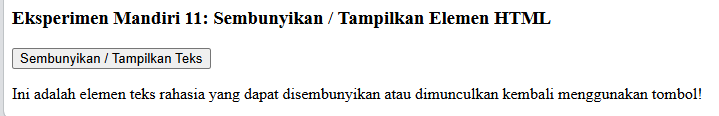
* **Screenshot Hasil (Teks Disembunyikan):**  
  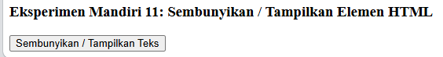

---

## ❓ Pertanyaan dan Tugas (Bagian H)

### 1. Jelaskan perbedaan `console.log()`, `alert()`, `prompt()`, dan `textContent`/`innerHTML`!
* **`console.log()`**: Mencetak pesan atau data ke panel Console browser untuk keperluan *debugging* oleh developer.
* **`alert()`**: Memunculkan kotak dialog pop-up peringatan kepada pengguna dengan tombol "OK".
* **`prompt()`**: Memunculkan kotak dialog pop-up input untuk meminta masukan teks dari pengguna.
* **`textContent`**: Mengatur atau membaca teks murni dari suatu elemen HTML tanpa merender tag HTML di dalamnya.
* **`innerHTML`**: Mengatur atau membaca teks beserta struktur tag HTML di dalam suatu elemen.

### 2. Apa perbedaan `let` dan `const`? Berikan contoh!
* **`let`**: Nilai variabel **dapat diubah kembali** (*reassignable*).
  ```javascript
  let umur = 20;
  umur = 21; // Valid
  ```
* **`const`**: Nilai variabel **tetap / konstan** dan tidak dapat diubah setelah diinisialisasi.
  ```javascript
  const pi = 3.14;
  // pi = 3.14159; // Error
  ```

### 3. Apa perbedaan operator `==` dan `===`?
* **`==` (Loose Equality)**: Membandingkan nilai tanpa memperhatikan tipe data (melakukan konversi tipe data otomatis / *type coercion*). Contoh: `'5' == 5` bernilai `true`.
* **`===` (Strict Equality)**: Membandingkan nilai **sekaligus tipe datanya** secara ketat. Contoh: `'5' === 5` bernilai `false`.

### 4. Jelaskan fungsi `if-else` dan `switch`. Kapan masing-masing dapat digunakan?
* **`if-else`**: Mengeksekusi blok kode berdasarkan pengujian kondisi logika boolean. Cocok digunakan untuk kondisi kompleks, rentang nilai (`>=`, `<=`), atau pengujian dengan kombinasi operator logika (`&&`, `||`).
* **`switch`**: Memilih salah satu blok kode berdasarkan pencocokan nilai pasti (*exact match*). Cocok digunakan untuk memilih satu tindakan dari banyak kemungkinan nilai pasti/diskrit.

### 5. Apa fungsi parameter dan `return` dalam `function`?
* **Parameter**: Variabel penampung pada deklarasi fungsi yang menerima nilai masukan (*argument*) saat fungsi dipanggil.
* **`return`**: Mengembalikan nilai hasil proses dari dalam fungsi ke kode pemanggil sekaligus menghentikan eksekusi fungsi.

### 6. Bagaimana JavaScript memilih elemen HTML menggunakan `document.getElementById()`?
Fungsi `document.getElementById("nama_id")` memindai *DOM Tree* dokumen HTML untuk mencari elemen tunggal yang memiliki nilai atribut `id` persis sama dengan parameter yang diberikan, lalu mengembalikan objek elemen tersebut agar dapat dimanipulasi.

### 7. Buat script untuk memvalidasi form agar nama tidak kosong dan nilai berada pada rentang 0-100!
```javascript
function validasiForm(nama, nilai) {
    const angka = Number(nilai);
    if (!nama || nama.trim() === "") {
        alert("Nama tidak boleh kosong!");
        return false;
    }
    if (nilai === "" || Number.isNaN(angka) || angka < 0 || angka > 100) {
        alert("Nilai harus berupa angka antara 0 - 100!");
        return false;
    }
    alert("Validasi Berhasil: Nama " + nama + ", Nilai " + angka);
    return true;
}
```